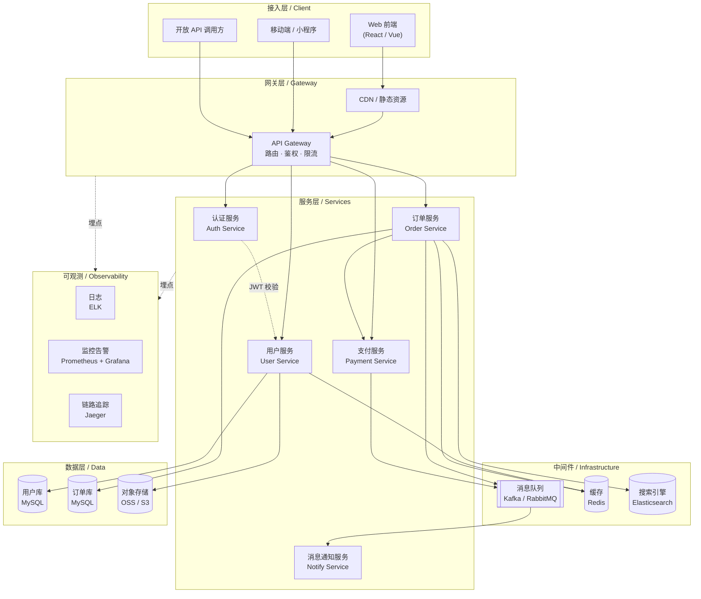

# contract

## [architecture-id1] 系统架构

架构树
```
- 系统
  - 子系统或组件
    - 子组件
```

说明: 解释节点职责、边界和关键依赖。架构树展示结构；本节补充树无法表达的约束。

## [architecture-id2] 事件输出架构

for example： tree展开
```
GuestEvent
├── 人类视图：终端 / 文本文件
│   ├── JNICALL / SYSCALL / SYSPROP / LOGCAT / COMMAND / ERROR / STDIO
│   └── BREAKPOINT / WATCHPOINT（默认不刷终端）
└── agent 视图：.rundroid-tmp/*.jsonl
    └── 与人类视图共用事件顺序和事实字段

EmulatorLog
└── kernel / linker / loader / memory / backend / hook（debug / info / error / fatal）

TelemetryEvent
└── 内部结构化数据：replay / diff / 统计 / UT/IT 断言
```

## [architecture-id3] 业务系统组件架构

可以使用mermaid 也可以使用 obsidian pele

